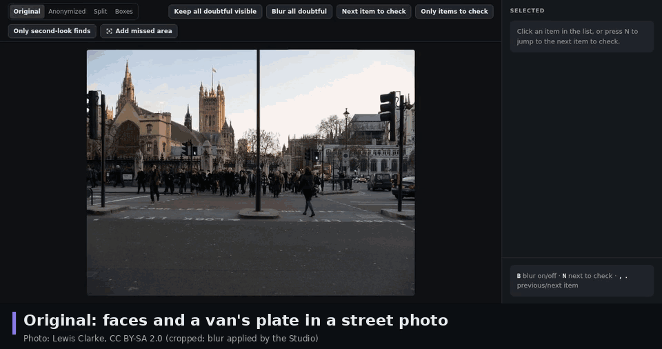
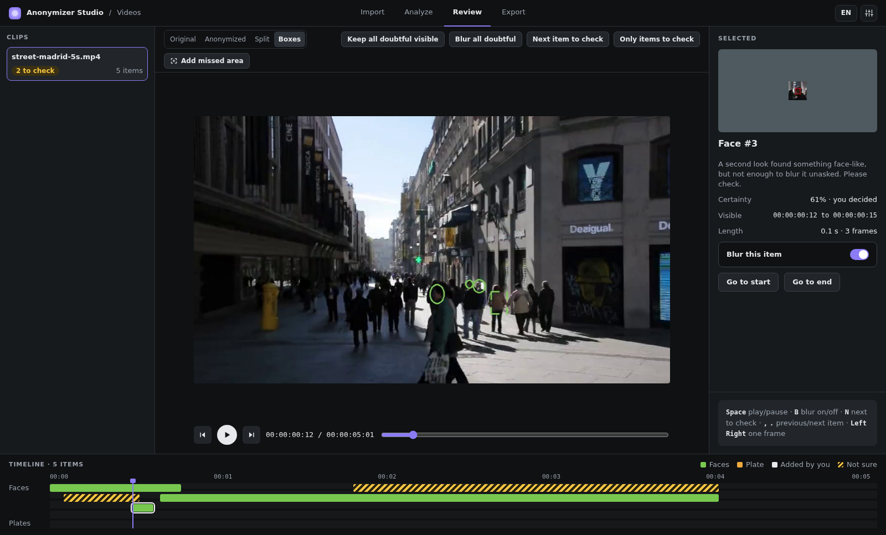

# Anonymizer Studio

Offline blurring of faces and licence plates in photos and video, with a review step for what the engine is not sure about.

Version 2.2.0. Python 3.10 or newer. Tried on Linux only. After the models are fetched, nothing is sent anywhere. If you write code that calls it, or an AI assistant does, start at `AGENTS.md`.

<p align="center">
<picture>
  <source media="(prefers-reduced-motion: reduce)" srcset="docs/media/hero-still.png">
  <source srcset="docs/media/hero.webp" type="image/webp">
  
</picture>
</p>

Photo: "London, Westminster, Bridge Street Pedestrian Crossing" by Lewis Clarke, CC BY-SA 2.0, cropped; the blur is applied by the Studio ([Licence and credits](docs/licence-and-credits.md)). The animation is made from real captures of the Studio 2.2: only the caption bands, the crops and a before-and-after card built from the real exported files were added, and the waits are sped up.

## Why

People who publish footage of places where strangers walk by and cars are parked, such as estate agents with walk-throughs and listing photos, and street and drone videographers, need faces and plates gone before the file goes online. Many cannot, or will not, upload the raw footage to a cloud service to get that done. Anonymizer Studio runs on your computer. The detectors decide first, a person checks what they were not sure about, and the export draws the blur at the original resolution and writes a report of every item found and what was done with it.

It does not find everything. A face or a plate that the detectors miss is neither blurred nor listed, and the report cannot say what was missed. The limits come with the figures, on [Accuracy and limits](docs/accuracy.md).

## What it does

- Finds faces and licence plates in photos and videos, at two detection levels: **Fast**, and **Careful**, which looks again with a heavier model at the places the first pass doubted.
- Lists what the detectors are not sure about as **Not sure** in a **Review** screen, where a person blurs or keeps each one, or marks an area the detectors missed.
- Blurs by default only the plate itself and the face itself, with a tight margin and a soft edge. A doubtful item is blurred when it is placed like a plate or a face, and otherwise listed and left visible.
- Writes the output at the original resolution, with the metadata and the GPS location of a photo removed, and a privacy report as PDF, CSV or JSON.
- Never changes an original and never replaces a file. A half-written file is never left under the output name.
- Works from the Python API as well as from the Studio, in seven interface languages.

## How it works, in four screens

The Studio is a page served by a program on your computer. The screenshots in [Your first video](docs/tutorials/first-video.md) come from the real engine on the public clips in `demo/`.



Footage: "Calle Preciados Madrid" by OsvaldoGago, CC BY-SA 3.0, cut and re-encoded ([Licence and credits](docs/licence-and-credits.md)).

1. **Import.** Choose photos, videos or folders, what to detect, how carefully to look, how to fill gaps and the blur. Formats it cannot process are refused with the reason.
2. **Analyze.** Each clip shows its progress and what has been found so far. Nothing is written yet.
3. **Review.** Original, anonymized, split and boxes views on a timeline. **Next item to check** jumps to the next doubtful item, `B` switches the blur of the selected one, and **Add missed area** draws a box for something the detectors missed.
4. **Export.** Destination, name pattern, reports and an optional side-by-side comparison video. The analysis is reused, so exporting only draws the blur.

## Install and start

Clone the repository (`git clone https://github.com/PabloMedinaBetancor/anonymizer-studio.git`) and, in its folder, on Ubuntu 22.04 with Python 3.10 or newer, run three commands:

```console
$ python3 -m venv .venv && .venv/bin/pip install -U pip && .venv/bin/pip install .
$ .venv/bin/python scripts/fetch_models.py
$ .venv/bin/anonymizer-studio
```

On Ubuntu and Debian, `python3 -m venv` stops with "ensurepip is not available" until you run `sudo apt install python3-venv`. The pip that Ubuntu 22.04 ships cannot build the package, which is why the first command upgrades it. After the first route, run `source .venv/bin/activate`, because the `python3` commands in this documentation assume the Python you installed into is the one on the `PATH`. That route was not run to the end on the test machines, which lacked `python3-venv`; the `--user` route was. Without a virtual environment, install for your own user:

```console
$ python3 -m pip install --user -U pip && python3 -m pip install --user .
$ python3 scripts/fetch_models.py
$ python3 -m anonymizer.ui
```

With `--user` the `anonymizer-studio` command is in your user script folder, which is not on the `PATH` until your next login, so start the Studio with `python3 -m anonymizer.ui`. The models are not in the package: `scripts/fetch_models.py` downloads them once, which is the only network use of the product. [Getting started](docs/getting-started.md) says where they are looked for, how to use them on a computer with no network, and what was tested where. Windows, macOS and Safari were not tried.

## Python API

The Studio is built on the same API, so anything it does a script can do. This block anonymises a sample photo with the defaults. Run it from the repository root. It writes `anonymized/westminster.jpg`.

```python
import os

import anonymizer

os.makedirs("anonymized", exist_ok=True)
result = anonymizer.anonymize_image("demo/street-westminster.jpg", "anonymized/westminster.jpg")
print("written:", result.output)
print("doubtful items left visible:", result.visible_check)
print("warnings:", list(result.warnings))
```

```text
# output
written: anonymized/westminster.jpg
doubtful items left visible: 4
warnings: ['warning.review.check_left_visible']
```

Read the last two lines. With the defaults, `Options.unsure="placed"`: a doubtful item (verdict `check`) is blurred only when it is placed like a plate or a face, and the others stay visible, listed in the report and counted in `Result.visible_check`. `Options(unsure="blur")` blurs every doubtful item, at the price of some blur on things that are not faces or plates. `Options(unsure="blur", fit="loose", plate_band=True)` is 2.1's behaviour. The report records who decided.

`Options.detection` is `"fast"` (the light models only) or `"careful"` (the default). **Experimental, not offered: Deep.** The Python API has `detection="deep"`, which runs the heavy model over the whole picture in tiles. The Studio does not offer it. It is slow, and [Accuracy and speed](docs/accuracy.md) keeps its figures for the record.

The full reference is on [the reference pages](docs/reference/index.md). The rules for code written by an AI assistant are in `AGENTS.md`.

## What to expect

The figures are read from the results files by a script. The condition of each is on [Accuracy and limits](docs/accuracy.md), and every measurement is in [docs/MEASURED.md](docs/MEASURED.md).

- On the 30 blind photos of the kind a real-estate agent takes, the Careful level with 2.1's settings hides 60.26% of 78 faces by default (Wilson interval 49.16-70.39). These are the only blind face figures, and there is none for the 2.2 defaults. On faces at least 40 px tall (blind photos and WIDER FACE together) it hides 87.91%. Of the 31 faces it misses on the blind photos, 21 are turned away or partly covered ([why faces are missed](docs/MISSES.md)).
- On the OpenALPR EU set, which was never used to choose a number, the 2.2 defaults hide 105 of 108 plates. On 60 street photos they hide 8 of 16 readable plates, which is too few for a rate.
- In video, on three sealed clips, Careful covers 115 of 137 faces at least 80 percent. In video the second look did not measurably add to Fast, and plates in video were not measured.

## What it guarantees about files

Originals are only read, and an output never replaces a file. An output is written under a hidden name and renamed only when it is complete and checked, so a stop, a crash or a changed source leaves nothing under the output name. A frame or photo on which a detector failed is never exported as clean. A photo leaves with only a short list of its metadata, and without its location unless you keep it. [Privacy](docs/concepts/privacy.md) has every guarantee with its limit, and [Privacy paths](docs/PRIVACY-PATHS.md) lists the way each one was closed, with its tests.

## Documentation

- Start: [Getting started](docs/getting-started.md), [Your first video](docs/tutorials/first-video.md), [Photos in Python](docs/tutorials/photos-in-python.md).
- Understand: [How it works](docs/concepts/how-it-works.md), [Privacy](docs/concepts/privacy.md).
- Do: [Review a video in code](docs/how-to/video-review-in-code.md), [Progress, cancel and errors](docs/how-to/progress-and-errors.md), and `examples/` for a script of each.
- Look up: [Reference](docs/reference/index.md), [The Studio](docs/reference/studio.md), [Command line](docs/reference/command-line.md).
- Judge: [Accuracy and limits](docs/accuracy.md), [FAQ and troubleshooting](docs/faq.md).
- About: [Changelog](CHANGELOG.md), [Release notes](docs/release-notes.md), [Licence and credits](docs/licence-and-credits.md).

## Repository

    src/anonymizer/        the package: api.py (the public API), contract.py, geometry.py
      engine/              blur, video reading and writing, tracks, photos, analysis, render, preview, comparison
      classes/             the face and the licence-plate modules (the models and the rules of each class)
      ui/                  the local server, session, worker process, settings, PDF report, the page and its texts
    tests/                 the test suite; tests/ui/ drives the page
    bench/                 benchmarks on public data, their truth files and results
    demo/                  public clips and photos, with SOURCES.csv
    docs/                  the documentation; truth-dataset/ is the labels as a separate dataset
    examples/              one script for each how-to guide
    scripts/               fetch_models.py, api_docs.py, fill_numbers.py and others
    packaging/windows/     install and launch for Windows (never run on Windows)

## Development

`pip install -e .` and `python3 scripts/fetch_models.py`, then `python3 -m unittest discover -s tests -t .`. The tests that need the real models are off unless `ANONYMIZER_HEAVY=1`; they are heavy, so run them under a memory cap. `README.md` is generated from `README.template.md`: the figures are `{metric}` markers read from `bench/results/`, and `python3 scripts/fill_numbers.py --publish` writes the filled copies. `--verify` checks that they are current. Edit the template, never `README.md`.

## Licence

The code of Anonymizer Studio is released under the MIT licence (`LICENSE`). The models, libraries and sample footage it uses keep their own licences; [Licence and credits](docs/licence-and-credits.md) lists them. The sample clips and photos in `demo/` and `examples/data/`, and the screenshots, frames and videos made from them, are CC BY-SA and are not covered by the MIT licence. The labels in `docs/truth-dataset/` are CC BY 4.0, except `docs/truth-dataset/labels-agpl/` and `bench/truth/plates/openalpr-eu.json`, which are AGPL-3.0.

## Support

Questions and bug reports: open an issue on GitHub; say the version (`anonymizer-studio --version`), what you did, and the exact message you saw. Work requests go through the author's Upwork profile.

Version 2.2.0. Written by Pablo Medina and built with a team of AI agents he directed.
