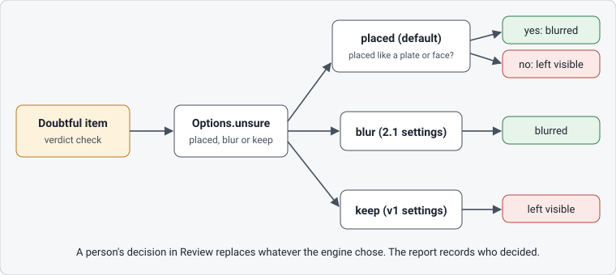

# How it works

What Anonymizer Studio looks for, how hard it looks, what it does with what it is not sure about, how the blur is drawn and what the report records. Read it before you trust a result or change a setting.

## The default rule

By default the Studio blurs the plate itself and the face itself, with a tight margin and a soft edge. What the detectors are not sure about is listed in Review and blurred only when it is placed like a plate or a face. A plate or a face the detectors do not find is neither blurred nor listed.

Everything found is an item: a `face`, a `plate`, or a `manual` area that a person drew with **Add missed area**. A sure item has the verdict `blur`. A doubtful item, one the detectors found but are not sure about, has the verdict `check`; the Studio's legend and badge call it **Not sure**.

## What is found

**Faces** are found in two steps. A light face model looks at the whole picture, on every second frame of a video by default. At the **Careful** level a second look then visits the places that first pass doubted or dropped, and the heads of people with no face found, enlarges each one and runs a heavier face model on it.

**Plates** are read as text on vehicles. A vehicle detector finds cars, motorcycles, buses and trucks, a text detector finds the writing on each, and a plate reader reads it. A text region is blurred by default when it is sure, small next to the vehicle, low on it and shaped like a plate. The reader takes out a region that reads as a word, such as a taxi sign, and brings in one that reads as a plate even if its position was rejected.

A doubtful item is **placed** when it is plate-sized or face-sized and where such a thing can be: low on a vehicle, or on a person. In a video a doubtful plate is never placed, so by default it is listed and left visible: review the plates of a video yourself.

Some things are never searched: a plate on something the vehicle detector does not take for a vehicle, and a vehicle below a minimum size, which the report only counts (`vehicles_too_small`). A small, blurred or distant face or plate can also score too low to be listed.

## Detection levels

The **Analyze** screen offers **Fast** and **Careful** (`detection="fast"` and `"careful"` in the Python API); Careful is the default. **Fast** runs the first pass only. **Careful** adds the second look, with RetinaFace for faces, and costs time, on a video much more than on a photo. The second look can only raise a decision: it confirms a doubtful item, brings back a dropped candidate or adds a missed head. It has a budget, 30 zones per photo by default (`max_zones`), and what the budget leaves out keeps the first pass's result and is counted, shown as a warning and written in the report.

`detection="deep"`, the heavy model over the whole picture in tiles, is experimental and in the Python API only: the Studio does not offer it, and no measured figure covers it. A model that fails is never silent: the file is not exported as clean (`IncompleteAnalysis`), and Careful without the heavy model's file is a `ModelLoadError`, never a quiet drop to Fast.

## Doubtful items

The usual doubtful items are text on a vehicle that is not shaped or placed like a plate, or reads as a word, and faces that the second look found or checked without confirming. **Review** shows the reason of each in plain words. Version 2.1 blurred them all, with wide margins: on a car park that put a blob over the side of every car and one over a bare wall, and the person reviewing lost sight of the real plates. The narrower rule of 2.2 has a cost too: a small, blurred or distant plate that the text detector scores low can be listed instead of blurred.

`Options.unsure` decides what happens to a doubtful item before anyone reviews it:

| `unsure` | A doubtful item is |
|---|---|
| `"placed"` (default) | blurred if it is placed like a plate or a face, otherwise left visible |
| `"blur"` | blurred; a person can turn it off |
| `"keep"` | left visible; a person can turn it on |

The 2.1 settings are `Options(unsure="blur", fit="loose", plate_band=True)`, and the v1 settings are `Options(detection="fast", unsure="keep", fit="loose")`. The Studio applies `"placed"`, and **Review** has **Blur all doubtful** and **Keep all doubtful visible** for a whole clip. A person's decision always wins, and the report records it. When doubtful items stay visible, the export says so: the Studio in a banner, the Python API in `Result.visible_check` and the warning `warning.review.check_left_visible`. It is not an error: a person has something left to look at.

## Blur and fit

The look of the blur is read when the file is written, so you can change it without analysing again.

| Setting | Values, default first | Studio control |
|---|---|---|
| `blur` | `"gaussian"`, `"pixelate"`, `"solid"` | **Style** |
| `strength` | 1.0 to 2.0 | **Strength** |
| `extra_margin` | 0.0 to 0.5 of the box, each side | **Extra margin** |
| `gap_fill` | `"camera"`, `"straight"`, `"hold"` | **Fill gaps between detections** |
| `remove_gps` | `True`, `False` | **Remove GPS and location from photos** |

`"gaussian"` turns the area into blocks about the size of a character and smooths them over an opaque core, so the soft edge never lets the original through. A strength below 1.0 is refused: at 0.8 the Gaussian blur already left more of a text than the repository's test allows. The blur covers the box plus a margin on each side: 6% of a face's width and 10% of its height, as an ellipse, and 15% and 25% of a plate's, as a rectangle, the smallest plate margin that hid nearly every readable plate of the development photos. That is the tight fit of 2.2, which the Studio always uses; `fit="loose"` gives 2.1's. Between two detections of a video, `gap_fill` moves the box with the camera, along a straight line, or holds it.

## The report

**Export** writes the privacy report next to the output, as PDF, CSV and JSON: `clip_anonymized.mp4` gets `clip_anonymized.report.pdf`, `.report.csv` and `.report.json`. It has one row per item, the ones left visible included. The PDF opens with "N items: X blurred, Y left visible", and numbers the rows from 1 in time order, while the CSV and JSON give the engine's `item_id`, which can skip numbers. A plate band has no real certainty: its score is the constant 1.0, and the PDF shows a dash. The PDF is printed by a Chrome, Edge or Chromium already on the computer; without one, the CSV and JSON are still written.

The report does not say what the detectors missed, and the PDF and the CSV do not say which classes were searched (the JSON does, under `options`). It does not record the blur settings: keep them with the files if you must show them later. And "left visible" does not mean safe to publish: a doubtful item left visible may be a plate.

Next: [Privacy](privacy.md), or [The Studio](../reference/studio.md) for every control.
