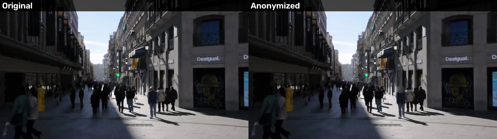

# Review a video in code

What a person does in **Review** can be done in code: analyse a video, decide on the items the detectors were not sure about, add an area they missed, render, and save the analysis so that it can be rendered again without running a detector. The same steps, with a command line, are `examples/review_video.py`.

The clip is `examples/data/street-madrid-5s.mp4`, the first 5 seconds of `demo/street-madrid.mp4`, a 15-second clip of a pedestrian street in Madrid ([Licence and credits](../licence-and-credits.md)). Run the blocks from the repository root, in order. The first is the long one, because it runs the detectors.

## Analyse and decide

`analyze` writes nothing and returns an `Analysis`. Its `items` are in order of appearance; each has a `verdict`, `"blur"` for a sure item and `"check"` for a doubtful one, and `blur` says whether it will be blurred. Give `analyze` an absolute path when the analysis will be saved and loaded from another folder.

<!-- docs-test: real-only - it decides on the doubtful items the real detectors find in the clip -->
```python
import os

import anonymizer

anon = anonymizer.Anonymizer()
analysis = anon.analyze(os.path.abspath("examples/data/street-madrid-5s.mp4"))
for item in analysis.items:
    state = "blurred" if item.blur else "visible"
    print(item.item_id, item.kind, item.verdict, state, item.decided_by, item.reason)
```

```text
# output
1 face blur blurred engine face.reason.seen_often
2 face check visible engine face.reason.low_verify
3 face check visible engine face.reason.low_verify
4 face blur blurred engine face.reason.seen_often
6 face check blurred engine face.reason.second_found
```

The ids are the engine's own and can skip a number, as here; the Studio and the PDF report number the items from 1 in time order. `reason` is a key, listed with its English sentence on [Errors and codes](../reference/errors.md#reasons).

A decision is `set_blur(item_id, True or False)`, and it marks the item `decided_by="person"`. This block blurs every doubtful item that is still visible, the cautious choice, then adds an area over a shop sign, which stands for anything the detectors do not look for, such as a name on a door. `add_area(frame_from, frame_to, box, follow)` takes pixel coordinates of the source at `frame_from`; `follow="camera"` moves the area with the camera, and `"fixed"` keeps it in place.

<!-- docs-test: real-only - it decides on the doubtful items the real detectors find in the clip -->
```python
for item in analysis.items:
    if item.verdict == "check" and not item.blur:
        analysis.set_blur(item.item_id, True)

area = analysis.add_area(0, analysis.frames - 1, (755, 210, 860, 242), follow="camera")
print("added area", area.item_id, area.kind, "blurred:", area.blur)
print(analysis.summary()["blurred"], "of", analysis.summary()["items"], "items will be blurred")
```

```text
# output
added area 7 manual blurred: True
6 of 6 items will be blurred
```

An added area has the kind `manual` and the verdict `blur`; `analysis.remove_area(area.item_id)` removes it. A detected item cannot be removed: turn it off with `set_blur`.

## Look, render and save

`preview` draws one frame with the current decisions and returns JPEG bytes, without running a detector. Its views are `"original"`, `"anonymized"`, `"boxes"` and `"split"`.

<!-- docs-test: real-only - it uses the analysis made by the real detectors in the first block -->
```python
os.makedirs("reviewed", exist_ok=True)
for view in ("anonymized", "boxes"):
    with open(f"reviewed/frame-{view}.jpg", "wb") as f:
        f.write(analysis.preview(60, view=view))
print(sorted(os.listdir("reviewed")))
```

```text
# output
['frame-anonymized.jpg', 'frame-boxes.jpg']
```

`render` writes the video from the analysis, with no detector, and never replaces a file. `save` writes the analysis as JSON, with a folder of item crops beside it, and replaces both if they exist.

<!-- docs-test: real-only - it uses the analysis made by the real detectors in the first block -->
```python
result = anon.render(analysis, "reviewed/reviewed.mp4")
analysis.save("reviewed/review.analysis.json")
anon.close()
print("written:", result.output)
print("doubtful items left visible:", result.visible_check)
print(sorted(os.listdir("reviewed")))
```

```text
# output
written: reviewed/reviewed.mp4
doubtful items left visible: 0
['frame-anonymized.jpg', 'frame-boxes.jpg', 'review.analysis.json', 'review.analysis.thumbs', 'reviewed.mp4']
```

## Render again from the saved file

Load the analysis and render it, in this process or another one. The new `Anonymizer` loads no model, because `render` needs none, and it takes the decisions in the file and nothing else.

<!-- docs-test: real-only - it uses the analysis made by the real detectors in the first block -->
```python
with anonymizer.Anonymizer() as anon:
    again = anon.render(anonymizer.load_analysis("reviewed/review.analysis.json"), "reviewed/again.mp4")
print("written:", again.output)
```

```text
# output
written: reviewed/again.mp4
```

An analysis saved by 2.1 loads in 2.2 and keeps the decisions made under 2.1's rule: analyse again to get the 2.2 defaults. A file from before 2.1 is refused with `error.analysis.version`. If the original changed or moved since the analysis, `render` raises `SourceChanged` or `FileNotFoundError`.

## Compare side by side

`compare_video(original, anonymized, target, captions=("Original", "Anonymized"))` writes one video twice as wide as the clip, with the original on the left and the anonymised clip on the right, to check the blur by eye on a moving shot. **Never publish it**: its left half shows every face and plate. The two videos must have the same size and length.

<!-- docs-test: real-only - it uses the video rendered from the real analysis above -->
```python
side = anonymizer.compare_video("examples/data/street-madrid-5s.mp4", "reviewed/reviewed.mp4", "reviewed/side-by-side.mp4")
info = anonymizer.media_info(side)
print("written:", side)
print("size:", info.width, "x", info.height, "frames:", info.frames)
```

```text
# output
written: reviewed/side-by-side.mp4
size: 1920 x 540 frames: 121
```



Like `render`, it never replaces a file and can be stopped with a `CancelToken`. In the Studio the same video is the switch **Comparison video** on **Export**.

The decisions are only as good as your review: a face or a plate that the detectors did not find has no item. Look at a `preview` or at the output, and add an area for what you see.
