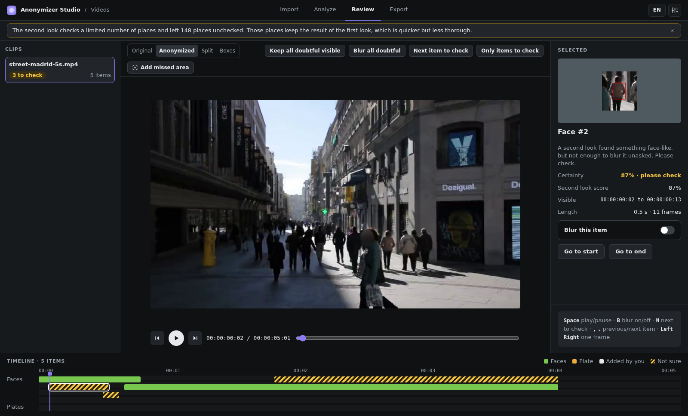
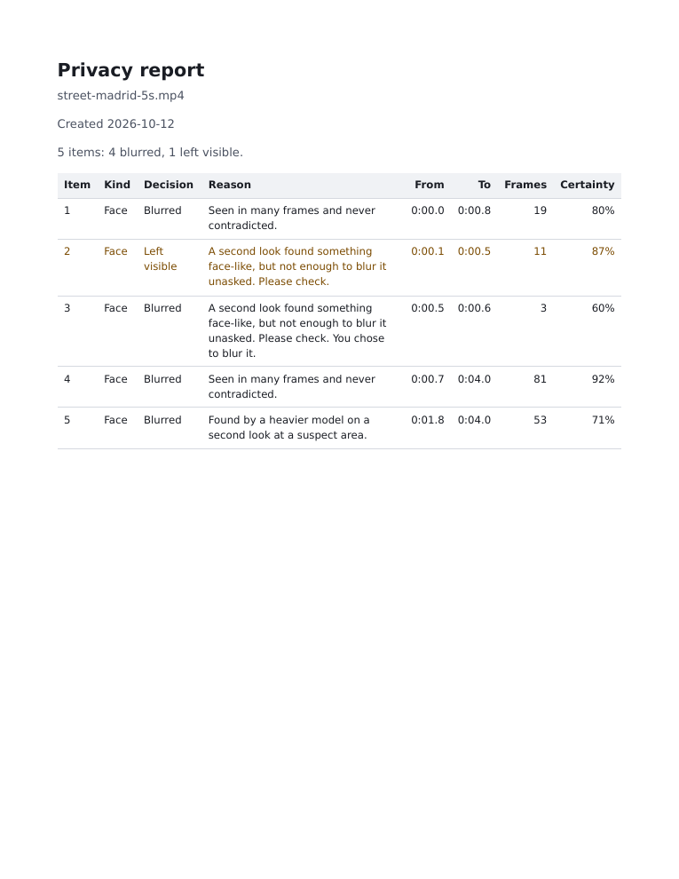

# Your first video

This tutorial takes a short street clip through the four screens of the Studio, from **Import** to the privacy report. You make one decision on the way and end with a blurred file and a report you can read. You need the Studio installed with its models ([Getting started](../getting-started.md)), and no code.

The clip is `examples/data/street-madrid-5s.mp4`, the first 5 seconds of `demo/street-madrid.mp4`, a 15-second clip of a pedestrian street in Madrid. It has no audio and no plates. Its credit is on [Licence and credits](../licence-and-credits.md). The screenshots come from one real run with the default settings, on a copy of the clip in `/tmp/studio-demo/Videos`.

## Import

Start the Studio, press **Import**, browse to `examples/data` and choose the clip. The clip is listed with a preview, and the settings are on the right. Leave them as they are: **Faces** and **License plates** on, **Careful**, gaps filled by following the camera, Gaussian blur. Press **Analyze 1 clip**.

## Analyze

The Studio reads the clip and shows its progress. Boxes with a dashed outline and a "FACE?" label are things the detectors are not sure about. Nothing is written yet. When the analysis ends, a banner says how many places the second look left unchecked: a video has more places than it can visit, and the others keep the first pass's result. Click the clip's card to open it in **Review**.

## Review

Review shows the clip with its items drawn on it, and a timeline with one bar per item. Here the detectors found five faces: two they were sure about and three they were not. The Studio calls those **Not sure** and draws them with a striped bar. Press `N` to jump to the first of them.

The panel on the right shows a crop of the item, the reason the detectors give, and the switch **Blur this item**. Face 2 was left visible because it is not placed like a face, and the crop shows a pedestrian's back: there is nothing to hide, so leave it. Press `N` again for face 3, a head in a crowd that lasts three frames. You cannot tell from the crop whether it faces the camera, and a blur costs nothing, so press `B` to blur it. The timeline marks the item as decided.

Many of the people far down the street are too small for the detectors and have no box. **Add missed area** lets you draw one over each, and choose whether it follows the camera or stays where you drew it.

## Export

Open **Export**. The output goes to a folder named `anonymized` next to the clip, as `street-madrid-5s_anonymized.mp4`, with the three privacy reports. Leave the comparison video off: it shows the original without any blur, so it is for checking, not for publishing. Press **Render 1 clip**. Rendering draws the blur from the analysis you already have, so it is much quicker. The screen lists the files it wrote, and a banner says that one doubtful item stays visible: face 2. Rendering again replaces nothing; the Studio adds `-2` to the names.

## Read the report

Open `street-madrid-5s_anonymized.report.pdf`.

The summary line counts the items, the blurred ones and the ones left visible. The table has one row per item, with the times it is seen from and to, its length in frames and the detectors' certainty. Face 2's row is tinted, because it is left visible. Face 3's reason ends with "You chose to blur it", because you overruled the detectors. The rows are numbered from 1 in time order; the CSV and JSON reports give the engine's own `item_id`, which can skip numbers, so the fifth row of this PDF is `item_id` 6.

## What you still check yourself

The report lists what was found and what was done. It does not list what the detectors missed. Before you publish the clip:

1. Play the output from start to end and look for faces that are not blurred. In this clip, the people far down the street are not blurred.
2. If that matters for your use, add an area over each one in **Review** and export again.
3. Look at every item the report says was left visible, and decide that none of them is a face or a plate.

Next: [How it works](../concepts/how-it-works.md) explains what the Studio blurs and why, and [The Studio](../reference/studio.md) lists every control.
